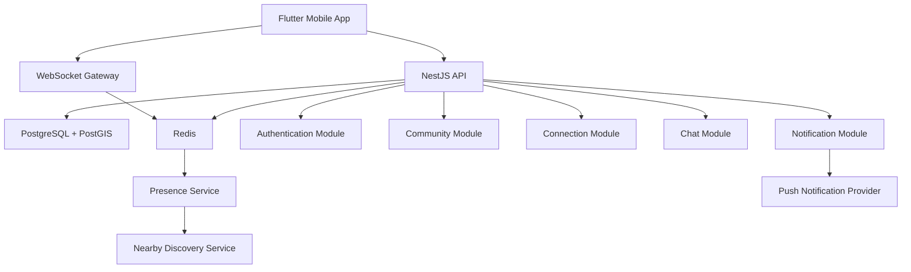

# Architecture

## 1. Monorepo layout

```text
psi-circle/
├── AGENTS.md
├── prd.md
├── docs/
├── apps/
│   ├── mobile/      # Flutter app
│   ├── backend/     # NestJS app
│   └── web/         # Next.js app (post-MVP priority)
└── docker-compose.yml
```

Single repository so the API contract (`docs/api/openapi.yaml`), the mobile app, and the
backend are always reviewed and versioned together.

## 2. High-level architecture



## 3. Backend module structure (`apps/backend/src`)

```text
src/
├── auth/            # register, login, refresh, logout, verify-email
├── users/           # user details/status/account deletion
├── profiles/        # username/display name/avatar/bio
├── communities/      # create/update/search/details
├── memberships/      # join/approve/reject/leave/ban
├── presence/         # visible/invisible/heartbeat/expiration
├── discovery/        # nearby search, privacy+block+community filters
├── connections/       # wave/accept/reject/list
├── chats/            # conversations
├── messages/          # send/retrieve/unread
├── notifications/     # nearby/wave/connection/chat push events
├── blocks/            # block/unblock
├── reports/           # user reports
├── common/            # shared pipes/guards/filters/decorators
├── database/          # Prisma module, migrations
├── redis/             # Redis client, GEO helpers, presence TTL
└── app.module.ts
```

Each module owns its controller, service, DTOs, and tests. Cross-module access goes
through exported providers, never by reaching into another module's internals.

## 4. Mobile structure (`apps/mobile/lib`)

Feature-first structure so each screen area maps 1:1 to a backend module and to a section
of the OpenAPI contract:

```text
lib/
├── core/
│   ├── network/        # Dio/http client, interceptors, error mapping
│   ├── models/          # Dart models generated/mirrored from openapi.yaml schemas
│   └── storage/          # secure token storage
├── features/
│   ├── auth/
│   ├── onboarding/
│   ├── communities/
│   ├── radar/
│   ├── connections/
│   ├── chat/
│   └── profile/
│       # each feature/: data/ (repository interface + mock + http impl),
│       #                domain/ (entities, use-cases),
│       #                presentation/ (screens, widgets, riverpod providers)
└── main.dart
```

Each feature's `data/` layer exposes a repository **interface**. Two implementations exist
during development:

- `Mock<Feature>Repository` — returns data shaped exactly like the `example:` blocks in
  `docs/api/openapi.yaml`. Used until the backend is ready.
- `Http<Feature>Repository` — calls the real backend. Swapped in once the corresponding
  backend module is implemented and verified against the contract.

UI/presentation code only depends on the repository interface, never on a concrete
implementation, so swapping mock → http does not require UI changes.

## 5. Data flow: presence & discovery (core feature)

1. Mobile asks for foreground location permission, explains why (PRD §4.4).
2. User taps **Visible**. Mobile sends `POST /presence/visible` with coordinates and
   `activeCommunityIds`.
3. Backend validates: authenticated, ACTIVE membership on each community id, valid
   coordinates, radius within limits, not globally blocked.
4. Backend writes an entry to Redis (`presence:{userId}`) with TTL (default 120s) and adds
   the user to a Redis GEO set per active community (e.g. `geo:community:{communityId}`).
5. Mobile sends a heartbeat (`POST /presence/heartbeat`) every 30–60s to refresh the TTL.
6. `GET /discovery/nearby` reads the caller's presence, does a Redis GEO radius query per
   active community, batch-filters candidates (membership ACTIVE, not blocked, privacy
   settings), computes a bucketed distance label, and returns only safe fields — never
   coordinates.
7. On **Invisible**, mobile calls `POST /presence/invisible` and the backend deletes the
   Redis key and GEO entries immediately.
8. If heartbeats stop, Redis TTL expires the key automatically — no manual cleanup job
   needed for the common case, but a safety sweep job may be added in Phase 6 to also
   detect/clean orphaned GEO set membership (GEO sets do not auto-expire per key).

## 6. Real-time events (WebSocket)

Namespaced, authenticated socket connection per user. Server never broadcasts
coordinates — only the already-safe payloads described in the contract.

```text
presence.updated
nearby.member.detected
connection.wave.received
connection.accepted
chat.message.created
chat.message.read
```

## 7. Why PostGIS is enabled but mostly unused in MVP

PRD §6.2 lists PostGIS as part of the stack, but presence (the only geospatial need) is
handled entirely in Redis (§8.11 of the PRD) and never persisted in PostgreSQL. PostGIS is
enabled on the database as a forward-looking assumption (e.g. future community location,
event venues) but no MVP table currently requires a geometry column. This is documented
here as an explicit assumption per the PRD's rule to document ambiguous decisions rather
than silently expand or drop scope.
