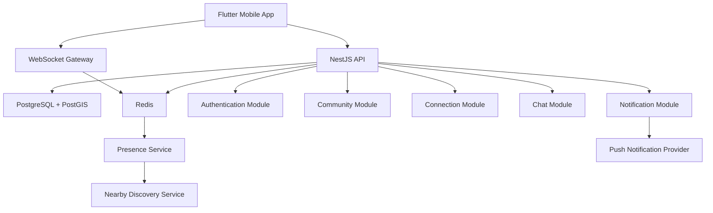

# Psi Circle — Product Requirements & Technical Specification

**Document type:** PRD + Technical Design + MVP Implementation Plan  
**Version:** 1.0  
**Status:** Initial specification  
**Product category:** Location-based community discovery / social networking

---

# 1. Product Overview

## 1.1 Product Concept

Psi Circle adalah aplikasi social discovery berbasis lokasi yang memungkinkan seseorang menemukan anggota komunitas yang sama ketika mereka sedang berada di tempat umum.

Contoh:

- Seorang anggota komunitas otomotif sedang berada di sebuah mall.
- Anggota lain dari komunitas yang sama juga sedang berada di sekitar mall tersebut.
- Keduanya mengaktifkan mode Visible di aplikasi.
- Psi Circle memberi tahu bahwa ada anggota komunitas lain di sekitar mereka.
- Mereka bisa saling menyapa, mengirim permintaan koneksi, dan mulai mengobrol setelah mendapat persetujuan.

Tujuan utamanya adalah menciptakan pengalaman sosial yang menyenangkan: pengguna bisa menemukan orang-orang dengan kesamaan minat atau identitas komunitas, bahkan ketika mereka tidak mengenakan atribut komunitas apa pun.

## 1.2 Problem Statement

Saat ini, komunitas biasanya berinteraksi melalui:

- WhatsApp groups.
- Telegram groups.
- Facebook groups.
- Forum online.
- Pertemuan atau acara komunitas.

Namun, interaksi tersebut umumnya terjadi secara online atau ketika ada acara yang sudah direncanakan.

Belum ada pengalaman yang sederhana untuk menemukan anggota komunitas yang sama secara spontan ketika mereka berada di tempat umum.

Masalah yang ingin diselesaikan:

1. Anggota komunitas tidak tahu apakah ada anggota lain di sekitarnya.
2. Sulit memulai interaksi spontan dengan orang yang memiliki kesamaan minat.
3. Identitas komunitas tidak selalu terlihat dari penampilan seseorang.
4. Komunitas kehilangan kesempatan untuk menciptakan interaksi offline secara alami.

## 1.3 Product Vision

**Make every public place an opportunity to discover people who share the same interests.**

Psi Circle ingin menjadi platform yang menghubungkan komunitas digital dengan kehidupan nyata.

## 1.4 Target Users

| User | Description |
|---|---|
| Community Members | Orang yang ingin menemukan anggota komunitas lain di sekitarnya |
| Community Organizers | Orang yang membuat dan mengelola komunitas |
| Social Explorers | Orang yang ingin menemukan komunitas berdasarkan minat |
| Event Participants | Orang yang ingin bertemu anggota komunitas ketika menghadiri acara |

Contoh komunitas:

- Automotive enthusiasts.
- Motorcycle communities.
- Cycling communities.
- Running communities.
- Gaming communities.
- University alumni.
- Photography communities.
- Professional communities.
- Hobby communities.
- Local communities.

Aplikasi tidak boleh mengasumsikan atau menampilkan afiliasi politik, agama, atau atribut sensitif lainnya tanpa tindakan eksplisit dan persetujuan pengguna.

---

# 2. Product Goals & Non-Goals

## 2.1 Goals

MVP harus mampu:

1. Membuat pengguna dapat mendaftar dan membuat profil.
2. Membuat pengguna menemukan dan bergabung dengan komunitas.
3. Membuat pengguna mengaktifkan atau menonaktifkan visibilitas lokasi.
4. Menampilkan anggota komunitas yang sedang Visible di sekitar pengguna.
5. Memberikan notifikasi ketika ada anggota lain di sekitar.
6. Memungkinkan pengguna mengirim dan menerima Wave.
7. Memungkinkan pengguna melakukan chat setelah koneksi disetujui.
8. Memberikan kontrol privasi dan keamanan yang jelas.

## 2.2 Non-Goals untuk MVP

Fitur berikut tidak perlu dibuat pada tahap pertama:

- Background tracking sepanjang hari.
- Tracking lokasi secara terus-menerus ketika aplikasi ditutup.
- Live navigation seperti Waze.
- Timeline perjalanan atau riwayat lokasi.
- Sistem rekomendasi berbasis AI.
- Video call.
- Marketplace komunitas.
- Sistem pembayaran atau subscription.
- Dashboard pemantauan lokasi anggota oleh admin.
- Fitur pencarian seseorang berdasarkan nomor telepon atau koordinat.
- Public directory yang mengungkapkan seluruh anggota komunitas.

Jangan memperluas scope MVP tanpa alasan teknis atau produk yang kuat.

---

# 3. Core User Experience

## 3.1 Main Navigation

Navigasi utama aplikasi:

1. **Radar** — menemukan anggota komunitas di sekitar.
2. **Communities** — melihat dan mengelola komunitas.
3. **Chats** — percakapan dengan koneksi.
4. **Profile** — profil dan pengaturan akun.

Radar menjadi halaman utama setelah pengguna login.

## 3.2 User Registration

Flow:

1. Pengguna membuka aplikasi.
2. Pengguna melakukan registrasi menggunakan email.
3. Pengguna melakukan verifikasi email.
4. Pengguna mengatur nama, username, dan foto profil.
5. Pengguna memilih beberapa minat.
6. Pengguna mencari atau bergabung dengan komunitas.
7. Pengguna diarahkan ke halaman Radar.

Authentication harus menggunakan sistem yang aman, termasuk password hashing, access token, refresh token, dan session revocation.

## 3.3 Community Management

Pengguna dapat:

- Membuat komunitas.
- Mencari komunitas.
- Bergabung dengan komunitas.
- Keluar dari komunitas.
- Melihat informasi komunitas.
- Melihat jumlah anggota.
- Mengundang anggota lain.

Community visibility:

- Public: dapat ditemukan dan pengguna dapat mengajukan keanggotaan.
- Private: hanya dapat ditemukan melalui undangan atau kode undangan.

Membership dapat memiliki status:

- PENDING
- ACTIVE
- REJECTED
- BANNED
- LEFT

Untuk MVP, komunitas private dapat menggunakan invitation code.

Admin komunitas hanya memiliki akses ke pengelolaan komunitas dan membership. Admin tidak boleh melihat lokasi real-time anggota.

## 3.4 Radar — Main Feature

Radar adalah fitur inti Psi Circle.

Ketika pengguna membuka Radar, aplikasi menampilkan:

- Peta area sekitar.
- Status visibilitas pengguna.
- Jumlah anggota yang Visible di sekitar.
- Anggota komunitas yang ditemukan.
- Jarak perkiraan dari pengguna.

Contoh tampilan:

**Radar**

"5 people from your communities are nearby."

Daftar anggota:

- Alex — Automotive Community — Approximately 300 m away.
- Daniel — Cycling Community — Approximately 700 m away.
- Michael — Photography Community — Approximately 1 km away.

Angka jarak hanya perkiraan dan tidak boleh memberikan informasi yang memungkinkan seseorang menemukan koordinat presisi pengguna lain.

Pengguna dapat memilih komunitas aktif untuk Radar. Hanya komunitas yang dipilih yang digunakan untuk discovery.

## 3.5 Visibility Modes

Sediakan tiga mode utama:

### Invisible

- Pengguna tidak muncul di Radar.
- Lokasi tidak dipublikasikan untuk discovery.
- Tidak menerima notifikasi proximity.
- Tidak ada anggota yang bisa menemukan pengguna melalui Radar.

### Visible

- Pengguna dapat ditemukan oleh anggota komunitas yang sama dan sedang Visible.
- Lokasi digunakan sementara untuk menghitung proximity.
- Pengguna dapat menerima notifikasi anggota lain di sekitar.
- Identitas dan informasi profil yang ditampilkan dibatasi oleh pengaturan privasi.

### Event Mode

- Pengguna mengaktifkan visibilitas khusus ketika menghadiri acara.
- Pengguna dapat memilih komunitas atau event yang relevan.
- Pengguna dapat memilih durasi visibilitas.
- Setelah durasi berakhir, status kembali menjadi Invisible.

Default aplikasi adalah **Invisible**. Pengguna harus secara eksplisit mengaktifkan Visible.

Sediakan tombol Visible/Invisible yang mudah ditemukan dan dapat digunakan dengan cepat.

## 3.6 Nearby Discovery

Ketika pengguna mengaktifkan Visible:

1. Aplikasi meminta izin lokasi saat digunakan.
2. Aplikasi mendapatkan posisi pengguna.
3. Aplikasi mengirimkan posisi sementara ke backend.
4. Backend mencari pengguna lain yang memenuhi kriteria discovery.
5. Backend mengembalikan hasil berupa jarak perkiraan dan informasi profil yang boleh ditampilkan.

Kriteria discovery:

- Kedua pengguna memiliki status ACTIVE pada komunitas yang sama.
- Kedua pengguna sedang Visible.
- Kedua pengguna tidak saling memblokir.
- Kedua pengguna memenuhi batas radius pencarian.
- Pengguna memenuhi pengaturan privasi masing-masing.

Default radius pencarian adalah 3 km. Radius dapat dikonfigurasi, dengan batas maksimum awal 10 km.

Hasil discovery harus menggunakan jarak yang dibulatkan atau dikelompokkan, bukan jarak GPS presisi.

Contoh:

- Less than 500 m.
- 500 m – 1 km.
- 1 – 3 km.
- 3 – 5 km.

## 3.7 Wave & Connection

Pengguna tidak boleh langsung mengirim pesan kepada orang asing tanpa persetujuan.

Flow:

1. Pengguna membuka profil anggota di Radar.
2. Pengguna menekan tombol Wave.
3. Penerima mendapat notifikasi.
4. Penerima dapat Accept atau Ignore.
5. Jika diterima, kedua pengguna menjadi koneksi.
6. Fitur Chat tersedia.

Status koneksi:

- NONE
- PENDING
- ACCEPTED
- REJECTED
- BLOCKED

Batasi pengiriman Wave untuk mencegah spam.

Contoh batas awal:

- Maksimal 20 Wave per hari.
- Tidak boleh mengirim Wave berulang kepada pengguna yang sama ketika masih pending.

Angka ini dapat dikonfigurasi dari backend.

## 3.8 Chat

Chat hanya tersedia setelah kedua pengguna menyetujui koneksi.

Fitur MVP:

- Text messages.
- Message timestamp.
- Unread message count.
- Conversation list.
- Block user.
- Report user.

Gunakan WebSocket untuk komunikasi real-time.

---

# 4. Privacy & Safety Requirements

Privasi merupakan bagian inti produk, bukan fitur tambahan.

## 4.1 Location Privacy

Aturan wajib:

1. Default visibility adalah Invisible.
2. Tidak boleh melakukan tracking lokasi tanpa persetujuan eksplisit.
3. MVP hanya menggunakan lokasi ketika aplikasi aktif dan pengguna mengaktifkan Visible.
4. Jangan menyimpan histori perjalanan.
5. Jangan memberikan koordinat GPS asli pengguna lain kepada client.
6. Jangan memberikan endpoint untuk mengambil koordinat anggota lain.
7. Jangan mengizinkan admin komunitas memantau lokasi anggota.
8. Pengguna harus dapat menonaktifkan visibilitas kapan saja.
9. Lokasi sementara harus otomatis kedaluwarsa.
10. Pengguna dapat memblokir siapa pun.

## 4.2 Location Data Retention

Gunakan Redis untuk menyimpan posisi sementara.

Contoh:

- Presence heartbeat: setiap 30–60 detik.
- Presence TTL: 120 detik.
- Jika heartbeat berhenti, pengguna otomatis dianggap Invisible.
- Saat pengguna menekan Invisible, presence harus segera dihapus.

Jangan menyimpan raw GPS coordinates di tabel histori database.

## 4.3 Data Access

Jangan pernah:

- Mengizinkan pengguna melihat posisi orang yang Invisible.
- Mengungkapkan koordinat tepat anggota lain.
- Menyediakan endpoint pencarian lokasi berdasarkan user ID.
- Membuat dashboard admin untuk melihat posisi anggota.
- Mengirimkan lokasi ke komunitas lain yang tidak dipilih.
- Membuat fitur tracking tersembunyi.

## 4.4 Safety Features

MVP harus memiliki:

- Block user.
- Report user.
- Mute notifications.
- Invisible mode.
- Leave community.
- Delete account.
- Location permission explanation.
- Rate limiting.

Tambahkan penjelasan yang jelas ketika meminta izin lokasi.

---

# 5. Functional Requirements

| ID | Feature | Priority |
|---|---|---|
| FR-001 | User registration | P0 |
| FR-002 | User login/logout | P0 |
| FR-003 | User profile | P0 |
| FR-004 | Community creation | P0 |
| FR-005 | Community discovery | P0 |
| FR-006 | Community membership | P0 |
| FR-007 | Visibility toggle | P0 |
| FR-008 | Location permission handling | P0 |
| FR-009 | Nearby member discovery | P0 |
| FR-010 | Approximate distance | P0 |
| FR-011 | Wave system | P0 |
| FR-012 | Connection acceptance | P0 |
| FR-013 | Real-time chat | P1 |
| FR-014 | Push notifications | P1 |
| FR-015 | Block user | P0 |
| FR-016 | Report user | P0 |
| FR-017 | Event Mode | P1 |
| FR-018 | Invitation code | P1 |
| FR-019 | Account deletion | P0 |
| FR-020 | Community admin tools | P1 |

P0 berarti wajib untuk MVP. P1 dapat dikerjakan setelah alur utama stabil.

---

# 6. Recommended Technology Stack

Gunakan stack berikut agar pengembangan terstruktur dan mudah dikembangkan.

## 6.1 Mobile Application

- Flutter.
- Dart.
- go_router atau Navigator 2.0 untuk navigation.
- Riverpod untuk data fetching dan state management (menggantikan peran TanStack Query).
- Riverpod juga digunakan untuk state lokal bila diperlukan (menggantikan peran Zustand).
- google_maps_flutter atau flutter_map sebagai alternatif map provider.
- geolocator untuk foreground location.
- flutter_local_notifications dan Firebase Cloud Messaging untuk push notifications.

Catatan: MVP tidak membutuhkan background location tracking.

## 6.2 Backend

- NestJS.
- TypeScript.
- PostgreSQL.
- PostGIS.
- Redis.
- Socket.IO atau NestJS WebSocket Gateway.
- JWT authentication.
- Swagger / OpenAPI.
- Prisma ORM atau ORM lain yang kompatibel dengan PostGIS.

Pilih satu ORM dan gunakan secara konsisten. Jika Prisma digunakan, implementasikan query PostGIS khusus menggunakan parameterized raw SQL ketika diperlukan.

## 6.3 Web Application

Gunakan Next.js untuk:

- Landing page.
- Public community pages.
- Admin community dashboard.
- Internal administration tools.

Web dashboard bukan prioritas utama MVP. Fokus pertama adalah mobile experience.

## 6.4 Infrastructure

- Docker.
- Docker Compose untuk development.
- PostgreSQL + PostGIS.
- Redis.
- Backend API.
- Mobile application.
- Object storage untuk foto profil.
- Push notification provider.

Buat konfigurasi environment terpisah untuk development, staging, dan production.

---

# 7. System Architecture

## 7.1 High-Level Architecture



## 7.2 Backend Modules

Struktur modul NestJS:

```text
src/
├── auth/
├── users/
├── profiles/
├── communities/
├── memberships/
├── presence/
├── discovery/
├── connections/
├── chats/
├── messages/
├── notifications/
├── blocks/
├── reports/
├── common/
├── database/
├── redis/
└── app.module.ts
```

Tiap modul harus memiliki tanggung jawab yang jelas.

### Auth Module

- Registration.
- Login.
- Refresh token.
- Logout.
- Email verification.

### Users Module

- User details.
- User status.
- Account deletion.

### Communities Module

- Create community.
- Update community.
- Search communities.
- Community details.

### Memberships Module

- Join community.
- Approve membership.
- Reject membership.
- Leave community.
- Ban member.

### Presence Module

- Enable visibility.
- Disable visibility.
- Heartbeat.
- Presence expiration.
- Active community selection.

### Discovery Module

- Find nearby users.
- Calculate approximate distance.
- Apply privacy filters.
- Apply community membership filters.
- Apply block filters.

### Connections Module

- Send Wave.
- Accept Wave.
- Reject Wave.
- List connections.

### Chats Module

- Create conversation.
- Send message.
- Retrieve messages.
- Unread messages.

### Notifications Module

- Nearby notification.
- Wave notification.
- Connection notification.
- Chat notification.

---

# 8. Database Design

Gunakan PostgreSQL sebagai primary database.

## 8.1 users

| Field | Type |
|---|---|
| id | UUID |
| email | VARCHAR UNIQUE |
| password_hash | VARCHAR |
| email_verified_at | TIMESTAMP NULL |
| status | ENUM |
| created_at | TIMESTAMP |
| updated_at | TIMESTAMP |

## 8.2 user_profiles

| Field | Type |
|---|---|
| id | UUID |
| user_id | UUID FK |
| username | VARCHAR UNIQUE |
| display_name | VARCHAR |
| avatar_url | TEXT NULL |
| bio | TEXT NULL |
| created_at | TIMESTAMP |
| updated_at | TIMESTAMP |

## 8.3 communities

| Field | Type |
|---|---|
| id | UUID |
| name | VARCHAR |
| slug | VARCHAR UNIQUE |
| description | TEXT |
| avatar_url | TEXT NULL |
| visibility | ENUM PUBLIC, PRIVATE |
| created_by | UUID FK |
| created_at | TIMESTAMP |
| updated_at | TIMESTAMP |

## 8.4 community_members

| Field | Type |
|---|---|
| id | UUID |
| community_id | UUID FK |
| user_id | UUID FK |
| role | ENUM MEMBER, ADMIN, OWNER |
| status | ENUM |
| joined_at | TIMESTAMP |

Unique constraint:

```text
UNIQUE(community_id, user_id)
```

## 8.5 connections

| Field | Type |
|---|---|
| id | UUID |
| requester_id | UUID FK |
| recipient_id | UUID FK |
| status | ENUM |
| created_at | TIMESTAMP |
| updated_at | TIMESTAMP |

Pastikan pasangan pengguna tidak menghasilkan duplikasi koneksi.

## 8.6 conversations

| Field | Type |
|---|---|
| id | UUID |
| created_at | TIMESTAMP |
| updated_at | TIMESTAMP |

## 8.7 conversation_members

| Field | Type |
|---|---|
| conversation_id | UUID FK |
| user_id | UUID FK |
| joined_at | TIMESTAMP |
| last_read_at | TIMESTAMP NULL |

## 8.8 messages

| Field | Type |
|---|---|
| id | UUID |
| conversation_id | UUID FK |
| sender_id | UUID FK |
| content | TEXT |
| created_at | TIMESTAMP |

## 8.9 user_blocks

| Field | Type |
|---|---|
| id | UUID |
| blocker_id | UUID FK |
| blocked_id | UUID FK |
| created_at | TIMESTAMP |

## 8.10 user_reports

| Field | Type |
|---|---|
| id | UUID |
| reporter_id | UUID FK |
| reported_user_id | UUID FK |
| reason | VARCHAR |
| description | TEXT NULL |
| status | ENUM |
| created_at | TIMESTAMP |

## 8.11 Presence Storage

Presence tidak disimpan sebagai histori di PostgreSQL.

Gunakan Redis sebagai temporary presence storage.

Contoh logical structure:

```text
presence:{userId}
```

Data:

```json
{
  "userId": "uuid",
  "latitude": -7.123456,
  "longitude": 112.123456,
  "activeCommunityIds": ["uuid"],
  "visibility": "VISIBLE",
  "updatedAt": "2026-11-15T00:00:00Z"
}
```

Data koordinat hanya boleh diproses oleh backend.

Gunakan Redis GEO atau struktur spatial yang sesuai untuk pencarian radius. Jangan mengembalikan koordinat tersebut melalui API.

Setiap presence harus memiliki TTL.

---

# 9. API Specification

Semua API menggunakan prefix:

```text
/api/v1
```

## 9.1 Authentication

```http
POST /auth/register
POST /auth/login
POST /auth/refresh
POST /auth/logout
POST /auth/verify-email
```

## 9.2 Profile

```http
GET    /users/me
PATCH  /users/me
DELETE /users/me
GET    /users/:userId/profile
```

Profile endpoint hanya boleh menampilkan informasi yang memang boleh dilihat oleh pemanggil.

## 9.3 Communities

```http
POST   /communities
GET    /communities
GET    /communities/:communityId
PATCH  /communities/:communityId
DELETE /communities/:communityId
POST   /communities/:communityId/join
POST   /communities/:communityId/leave
GET    /communities/:communityId/members
```

Endpoint membership management harus memvalidasi role dan permission.

## 9.4 Presence

```http
POST /presence/visible
POST /presence/invisible
POST /presence/heartbeat
GET  /presence/status
```

Contoh request:

```json
{
  "latitude": -7.123456,
  "longitude": 112.123456,
  "activeCommunityIds": ["community-uuid"]
}
```

Server harus memvalidasi:

- User sudah authenticated.
- User memiliki membership ACTIVE pada komunitas yang dipilih.
- User memberikan izin lokasi.
- Koordinat valid.
- Radius pencarian tidak melewati batas.
- User tidak sedang diblokir dalam hubungan yang relevan.

## 9.5 Discovery

```http
GET /discovery/nearby
```

Query parameters:

```text
radius=3000
communityId=uuid
```

Contoh response:

```json
{
  "data": [
    {
      "userId": "uuid",
      "displayName": "Alex",
      "username": "alex123",
      "avatarUrl": null,
      "community": {
        "id": "uuid",
        "name": "Automotive Community"
      },
      "distanceLabel": "300-500 m"
    }
  ]
}
```

Response tidak boleh mengandung latitude atau longitude pengguna lain.

## 9.6 Connections

```http
POST /connections/wave
GET  /connections/requests
POST /connections/:connectionId/accept
POST /connections/:connectionId/reject
GET  /connections
```

## 9.7 Chat

```http
GET  /chats
POST /chats
GET  /chats/:conversationId/messages
POST /chats/:conversationId/messages
```

Pastikan hanya anggota conversation yang dapat membaca dan mengirim pesan.

## 9.8 Safety

```http
POST   /users/:userId/block
DELETE /users/:userId/block
POST   /reports
GET    /users/me/blocked
```

Semua endpoint harus melakukan authorization di backend. Jangan hanya mengandalkan validasi UI.

---

# 10. Real-Time Communication

Gunakan WebSocket untuk:

- Presence status updates.
- Nearby member notifications.
- Wave notifications.
- Connection updates.
- Chat messages.

Contoh event:

```text
presence.updated
nearby.member.detected
connection.wave.received
connection.accepted
chat.message.created
chat.message.read
```

WebSocket harus menggunakan authentication.

Jangan melakukan broadcast koordinat pengguna.

Kirim hanya event yang dibutuhkan oleh penerima yang berhak.

Untuk MVP, jangan mengirim update lokasi setiap detik.

Gunakan strategi update adaptif:

- Ketika pengguna mulai Visible: kirim lokasi.
- Ketika bergerak cukup jauh: update lokasi.
- Ketika interval heartbeat tercapai: refresh presence.
- Ketika pengguna Invisible: hapus presence.
- Ketika aplikasi berhenti mengirim heartbeat: presence kedaluwarsa.

---

# 11. Nearby Discovery Algorithm

Discovery merupakan bagian paling penting dari aplikasi.

Alur:

1. Ambil user yang sedang Visible.
2. Ambil komunitas aktif pengguna.
3. Cari kandidat di sekitar menggunakan Redis GEO.
4. Filter berdasarkan community membership.
5. Filter berdasarkan block relationship.
6. Filter berdasarkan privacy settings.
7. Hitung jarak perkiraan.
8. Kelompokkan jarak.
9. Return hasil tanpa koordinat asli.

Pseudocode:

```typescript
async function findNearbyMembers(currentUser: User) {
  const currentPresence = await presenceService.get(currentUser.id);

  if (!currentPresence) {
    return [];
  }

  const candidates = await presenceService.findNearby({
    latitude: currentPresence.latitude,
    longitude: currentPresence.longitude,
    radius: 3000,
  });

  const eligibleCandidates =
    await discoveryService.filterEligibleUsers({
      currentUserId: currentUser.id,
      candidates,
      communityIds: currentPresence.activeCommunityIds,
    });

  return discoveryService.toSafeDiscoveryResponse(
    eligibleCandidates,
  );
}
```

Implementasi harus memperhatikan performa dan tidak melakukan query database satu per satu untuk setiap kandidat.

Gunakan batch queries dan index yang tepat.

---

# 12. UI/UX Requirements

## 12.1 Design Direction

Aplikasi harus terasa:

- Modern.
- Friendly.
- Social.
- Lightweight.
- Easy to understand.
- Privacy-conscious.

Hindari tampilan seperti aplikasi surveillance atau dashboard monitoring kendaraan.

Gunakan desain mobile-first.

## 12.2 Main Screens

### Screen 1 — Onboarding

- Welcome screen.
- Create account.
- Login.
- Profile setup.
- Interest selection.

### Screen 2 — Community Discovery

- Search community.
- Recommended communities.
- Join community.
- Create community.

### Screen 3 — Radar

Komponen:

- Map.
- Visibility toggle.
- Nearby count.
- Community filter.
- Nearby members list.
- Profile preview.

### Screen 4 — Member Profile

Komponen:

- Avatar.
- Display name.
- Username.
- Shared community.
- Bio.
- Approximate distance.
- Wave button.
- Block/report actions.

### Screen 5 — Wave Requests

- Incoming requests.
- Accept.
- Ignore.
- Connection status.

### Screen 6 — Chats

- Conversation list.
- Message screen.
- Unread count.
- Block/report actions.

### Screen 7 — Profile & Settings

- Edit profile.
- Visibility settings.
- Location permission.
- Notification preferences.
- Blocked users.
- Delete account.
- Logout.

---

# 13. Non-Functional Requirements

## Performance

- API response target: under 500 ms for common operations under normal load.
- Discovery should use spatial indexing or Redis GEO.
- Avoid N+1 database queries.
- Use pagination for lists.
- Use WebSocket for real-time events.

## Scalability

- Backend must be modular.
- Presence should be stored separately from permanent user data.
- Redis should support ephemeral presence.
- PostgreSQL should use appropriate indexes.
- Services should be stateless where possible.

## Security

- Passwords must be hashed.
- JWT access token should have short expiration.
- Refresh tokens should be revocable.
- API endpoints must validate authorization.
- Add rate limiting.
- Validate all user input.
- Prevent IDOR vulnerabilities.
- Use parameterized database queries.
- Avoid logging raw location coordinates.
- Protect WebSocket connections.

## Reliability

- Presence must expire automatically.
- App must recover when network reconnects.
- WebSocket reconnection should be supported.
- Failed push notifications should not break core features.
- Location permission denial should not crash the app.

## Privacy

- No location history.
- No hidden tracking.
- No exact location exposure.
- No admin location surveillance.
- Clear visibility controls.
- Account deletion must remove or anonymize associated personal data according to the applicable retention policy.

---

# 14. MVP Development Roadmap

Implement in phases. Do not attempt to build everything simultaneously.

## Phase 1 — Project Foundation

- Setup monorepo or clearly separated applications.
- Setup Flutter app.
- Setup NestJS backend.
- Setup PostgreSQL + PostGIS.
- Setup Redis.
- Setup Docker Compose.
- Setup environment configuration.
- Setup API documentation.
- Setup linting and formatting.
- Setup basic CI.

**Deliverable:** Running development environment.

## Phase 2 — Authentication & Community

- Registration.
- Login.
- Refresh token.
- User profile.
- Community CRUD.
- Community search.
- Membership management.
- Invitation code.

**Deliverable:** Users can create accounts and join communities.

## Phase 3 — Presence & Radar

- Location permission.
- Visibility toggle.
- Presence heartbeat.
- Redis presence storage.
- TTL expiration.
- Nearby discovery.
- Community filtering.
- Approximate distance.
- Radar UI.

**Deliverable:** Users can discover nearby members.

This is the most important MVP milestone.

## Phase 4 — Social Interaction

- Member profile preview.
- Wave.
- Accept/reject connection.
- Connection list.
- Block user.
- Report user.

**Deliverable:** Users can safely connect with people they discover.

## Phase 5 — Chat & Notifications

- WebSocket setup.
- Chat conversations.
- Text messaging.
- Unread counts.
- Push notifications.
- Wave notifications.
- Nearby notifications.

**Deliverable:** Users can communicate in real time.

## Phase 6 — Stabilization

- Security testing.
- Privacy testing.
- Location edge cases.
- Network interruption testing.
- Performance testing.
- UI polish.
- Account deletion.
- Production deployment.

**Deliverable:** MVP ready for controlled beta testing.

---

# 15. Acceptance Criteria

The MVP is considered functional when all of the following work:

### Authentication

- User can register.
- User can log in.
- User can log out.
- User can refresh their session.
- User can edit their profile.

### Community

- User can create a community.
- User can search communities.
- User can join a public community.
- User can join a private community through invitation.
- User can leave a community.
- User cannot use a community for discovery without ACTIVE membership.

### Presence

- User starts Invisible by default.
- User can activate Visible.
- User can activate Invisible immediately.
- Presence expires when heartbeat stops.
- Presence is not available to community admins.
- No raw location is returned to another user.

### Discovery

- User A and User B share an active community.
- Both activate Visible.
- Both are within the configured radius.
- User A can discover User B.
- User A cannot discover an Invisible user.
- Users outside the shared community cannot discover each other through that community.
- Blocked users cannot discover each other.
- Discovery response contains approximate distance only.

### Connection

- User can send a Wave.
- Recipient can accept or reject.
- Chat is available only after acceptance.
- Blocked users cannot initiate new connections.

### Chat

- Connected users can send messages.
- Messages arrive in real time.
- Non-members cannot access conversations.

### Safety

- User can block another user.
- User can report another user.
- User can disable visibility.
- User can delete their account.

---

# 16. Testing Strategy

Create automated tests for:

## Unit Tests

- Authentication service.
- Community membership rules.
- Presence service.
- Discovery filtering.
- Connection state transitions.
- Block rules.

## Integration Tests

- Registration and login.
- Join community.
- Enable/disable presence.
- Heartbeat expiration.
- Nearby discovery.
- Wave and connection acceptance.
- Chat authorization.

## Privacy Tests

These tests are mandatory:

1. Invisible users must never appear in discovery.
2. API responses must never expose another user's raw coordinates.
3. Community admins must never access member location.
4. Users outside the relevant community must not discover its members.
5. Blocked users must not discover each other.
6. Expired presence must not appear in discovery.
7. Users cannot activate discovery for communities where they are not ACTIVE members.

---

# 17. Product Metrics

Track product usage using privacy-preserving aggregated metrics.

Important metrics:

| Metric | Purpose |
|---|---|
| Daily Active Users | Measure daily engagement |
| Weekly Active Users | Measure retention |
| Communities Created | Measure community growth |
| Active Community Memberships | Measure network size |
| Visible Sessions | Measure feature adoption |
| Nearby Discoveries | Measure discovery activity |
| Waves Sent | Measure social interaction |
| Wave Acceptance Rate | Measure interaction quality |
| Connections Created | Measure successful connections |
| D7 Retention | Measure early retention |

Do not use location history or precise coordinates for analytics.

---

# 18. Monetization Strategy

The initial product should be free.

The main goal of the first stage is user growth and network effects.

Potential future revenue:

### Free

- Create profile.
- Join communities.
- Basic Radar.
- Nearby discovery.
- Wave.
- Basic connections.
- Basic chat.

### Community Pro

Potential paid features:

- Community branding.
- Custom community page.
- Advanced community management.
- Event creation.
- Invitation management.
- Community engagement statistics.
- Moderation tools.

Paid community features must not include surveillance or access to members' live locations.

Do not implement monetization in the MVP.

---

# 19. Important Product Decisions

Use these assumptions for the first implementation:

| Decision | MVP Default |
|---|---|
| Platform | Android and iOS |
| Initial market | Global-ready, English-first |
| Default visibility | Invisible |
| Discovery scope | Shared active communities |
| Location permission | While using the app |
| Background tracking | Not supported |
| Default radius | 3 km |
| Maximum radius | 10 km |
| Location storage | Redis only, temporary |
| Presence TTL | 120 seconds |
| Chat | Only after mutual acceptance |
| Admin location access | Not allowed |
| Membership | Public or private |
| Monetization | Not included |
| Location history | Not collected |

---

# 20. Instructions for AI Coding Agent

You are the senior software architect and full-stack engineer responsible for implementing Psi Circle.

Your responsibility is to build a production-minded MVP based on this specification.

## General Rules

1. Read the complete PRD before writing code.
2. Do not implement the entire application in one step.
3. Start by inspecting the existing repository.
4. If the repository is empty, initialize the project structure.
5. Use Dart for the Flutter mobile application, and TypeScript for the backend and web application.
6. Follow modular architecture.
7. Keep business logic out of controllers and UI components.
8. Use DTO validation on the backend.
9. Document all API endpoints.
10. Add tests for critical business rules.
11. Do not hardcode secrets.
12. Provide `.env.example`.
13. Use Docker Compose for local development.
14. Do not introduce unnecessary dependencies.
15. Do not silently change product requirements.
16. If a requirement is ambiguous, document the assumption before implementing it.

## Privacy Rules — Mandatory

These rules must never be violated:

- Never implement hidden location tracking.
- Never track users while Invisible.
- Never expose raw coordinates to other users.
- Never create a community admin endpoint for live location monitoring.
- Never persist user movement history.
- Never allow discovery outside eligible shared communities.
- Always enforce block rules on the backend.
- Always use presence expiration.
- Always require explicit user consent before enabling visibility.

If an implementation conflicts with these rules, prioritize privacy and security.

## Implementation Workflow

For each phase:

1. Inspect current project structure.
2. Identify required modules.
3. Create an implementation plan.
4. Implement the phase.
5. Run lint and type checking.
6. Run relevant tests.
7. Fix errors.
8. Update documentation.
9. Report completed work.
10. List remaining tasks and known issues.

Do not proceed to the next major phase if the current phase has unresolved critical errors.

## Required Documentation

Maintain these files:

```text
docs/
├── PRD.md
├── ARCHITECTURE.md
├── DATABASE.md
├── API.md
├── PRIVACY_AND_SECURITY.md
├── DEVELOPMENT_PLAN.md
└── PROGRESS.md
```

Update `PROGRESS.md` after every completed phase.

## First Task

Do not start implementing all features immediately.

First:

1. Analyze the repository.
2. Propose the project structure.
3. Confirm the technology choices.
4. Identify dependencies.
5. Create a phased implementation plan.
6. Identify architectural risks.
7. Create the initial documentation.
8. Set up the development environment.

Then implement Phase 1 only.

At the end, provide a concise report containing:

- What was created.
- Architecture decisions.
- Commands to run the project.
- Environment variables required.
- Tests executed.
- Remaining tasks.

---

# 21. Definition of Success

Psi Circle succeeds when users naturally think:

"I wonder if there are people from my community around here."

They open Psi Circle, activate Visible, and discover people nearby who share their interests.

The product should make discovering people feel natural, safe, fun, and voluntary.

**The core value is not tracking people. It is helping people discover each other.**